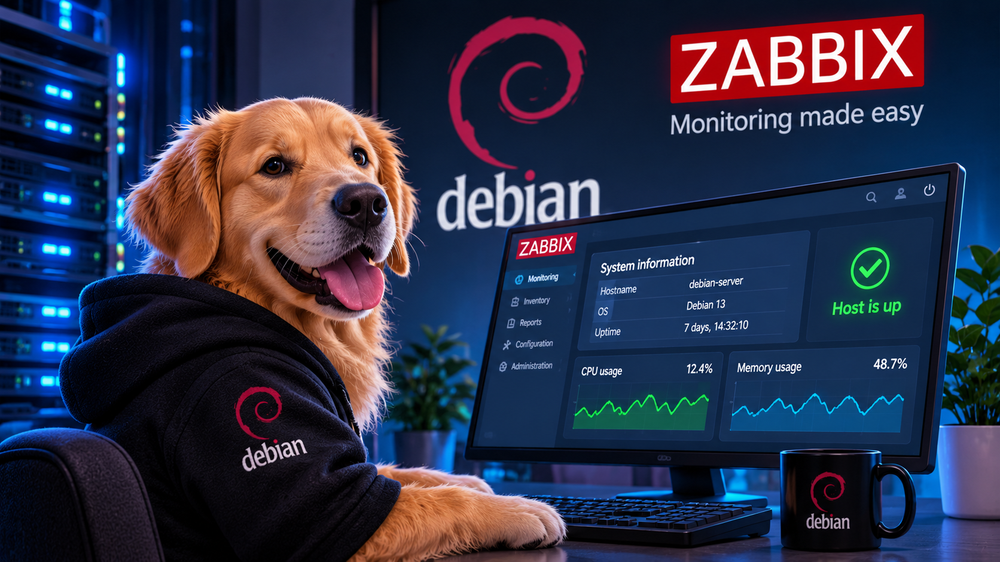

# Git a Vagrant – první Linux server

Zkopíroval jsem si z githubu

## 1. Příprava repozitáře

Smazal jsem zbytečné soubory a přejmenoval jsem Vagrantfile-debian na Vagrantfile

## 2. Vyberte si distribuci a připravte server

Debian

## 3. Ošetřete soubory, které do Gitu nepatří


## 4. Spusťte svůj server

V terminálu na svém počítači přejděte z kořene repozitáře do adresáře serveru a spusťte jej:

```bash
cd srv01
vagrant up
vagrant status
vagrant ssh
```

První spuštění může trvat déle kvůli stažení boxu. Po přihlášení do Linuxu ověřte distribuci:

```bash
cat /etc/os-release
```

Z virtuálního serveru se odhlaste příkazem `exit`. Po dokončení práce můžete server vypnout příkazem `vagrant halt`, který zadáte na svém počítači v adresáři `srv01`.

## 5. Vygenerujte kontrolní kód na serveru

- **Distribuce a verze:** Debian GNU/Linux 13 (trixie)
- **Použitý Vagrant box:** `bento/debian-13`
- **Adresář serveru:** `srv01`
- **Výsledek spuštění a přihlášení:** Virtuální server se úspěšně spustil příkazem `vagrant up` a přihlášení přes `vagrant ssh` funguje bez problémů.
- **Případné problémy a jejich řešení:** Ve virtuálním stroji nefungovalo stažení ověřovacího skriptu z GitHubu kvůli chybě překladu DNS (`Could not resolve host`). Skript byl proto zkopírován a spuštěn lokálně ze sdílené složky `/vagrant`.
- **Kontrolní kód a záznam ze serveru:**

**Kontrolní kód:** `SPOS-3I-b36011c57d69c79e6a2787327788e13e35381f134ebb6b7c08678b973e7e3a49`

```text
Úloha: git-vagrant / SPOŠ / 3. I / v1
Distribuce: Debian GNU/Linux 13 (trixie)
Hostname: debian13
Kernel: 6.12.48+deb13-amd64
Virtualizace: oracle
Čas UTC: 2026-11-20T07:56:01Z
Náhodné ID: 6f47f04f-39c8-4dad-8828-8d9bf01b29c7
```

## 6. Bonus: vlastní tematický obrázek

- Nechte si pomocí AI vytvořit vlastní obrázek na téma **Linux, Git, Vagrant a virtuální servery**.
- Uložte jej do adresáře `Images`, například jako `Images/muj-linux-server.png`.
- Nahraďte úvodní obrázek v tomto README odkazem na svůj soubor. Upravte také jeho alternativní popis:

```markdown

```

- Do části **Moje řešení** doplňte použitý AI nastroj a zadání (prompt).
- Obrázek přidejte do Gitu a na GitHubu ověřte, že se v README zobrazuje.

## 7. Uložte a odevzdejte práci


### Očekávaná struktura

```text

### Kontrola před odevzdáním

- [ ] Mám vlastní adresář serveru a v něm správně pojmenovaný `Vagrantfile`.
- [ ] Vybral/a jsem Linuxovou distribuci ze vzorů ročníkového projektu.
- [ ] Server se spustí a mohu se do něj přihlásit pomocí `vagrant ssh`.
- [ ] `.gitignore` vylučuje `.vagrant/` a žádné soubory z něj nejsou sledované Gitem.
- [ ] Na serveru jsem spustil/a ověřovací skript a vložil/a kód i celý záznam do části Moje řešení.
- [ ] Doplnil/a jsem část Moje řešení a odeslal/a změny do GitHub Classroom repozitáře.

## Moje řešení


## Nápověda a odkazy

- [Vagrant – příklady VM v ročníkovém projektu](https://github.com/sposdknl/2026-sposdk-osy/tree/main/Vagrant)
- [Jak probíhá výuka operačních systémů na SPOŠ](https://open-tech.cz/2024/09/01/operacni-systemy-na-spos-rovnou-do-praxe/)
- [Dokumentace Vagrantu](https://developer.hashicorp.com/vagrant/docs)
- [Dokumentace .gitignore](https://git-scm.com/docs/gitignore)
